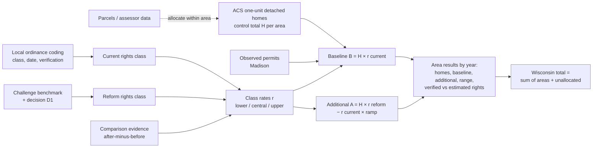

# Gate 1: ADU Scope and Model Outline

Prepared 2026-10-23 by the conductor for owner review. Revision 2, after independent review. Status: **proposal, not adopted**. Rates in the worked example are the policy agent's *proposed* Gate 3 values or labeled illustrations; none are adopted at Gate 1.

## One-page scope

**Question the ADU MVP answers.** If Wisconsin enacted the challenge ADU reform, how many *additional* ADU units would local governments authorize by building permit over five years, compared with current local law, how confident are we, and where would they occur?

**Reform modeled (challenge benchmark).** One ADU allowed on every parcel with an existing single-family home; detached and semi-detached (attached) ADUs of at least 600 sq ft allowed; no additional parking required. The reform adds only rights a municipality does not already grant. Wisconsin has no statewide ADU law today (all four 2025–26 bills died; see [POLICY_EVIDENCE_MAP.md §1](POLICY_EVIDENCE_MAP.md)), so current law is entirely local.

**Open interpretation (owner decision D1).** The benchmark does not say whether "allow" overrides owner-occupancy and related-occupant rules (New Berlin has both). Proposal: model **"full"** (the reform removes them) as the headline and **"form-only"** (forms allowed, occupancy rules stay) as a named variant.

**Outcome.** ADU units authorized at local building-permit issuance, counted as dwelling units, not permit documents. New detached and attached ADUs are the headline; conversions that create a new unit are shown separately; legalizations of existing units are tracked but never counted as production. Applications, issuance, completion, and net stock change stay separate. This is *not* the Census BPS series (BPS does not identify ADUs and does not count conversions); Census BPS is used for statewide production context only. ADU counts are gross: some ADUs may replace housing that would otherwise have been built, which the model does not estimate (stated limitation).

**Dates (owner decision D2).** The 2025–26 session has ended, so a real bill could take effect no earlier than mid-2027 and more plausibly 2028. Proposal: use a **stylized modeling convention**: the reform takes effect at the start of forecast year 1, forecast years 1–5 are labeled 2027–2031, and current local law is frozen as of **2026-10-31**. A 6–12-month implementation lag is tested as a sensitivity rather than built into the headline. 2026 is a bridge year under current law, reported separately and excluded from five-year totals.

**Geography.**

- *Policy authority:* municipality (Wisconsin has about 190 cities, 410 villages, 1,250 towns, roughly 1,850 municipalities, plus 72 counties, about 1,920 zoning-relevant jurisdictions). Towns under county zoning take the county ordinance; towns with no zoning get their own class. Census BPS lists about 1,150 Wisconsin permit-issuing places, which is a reporting frame, not the jurisdiction count.
- *Statewide ledger:* every municipality appears, with inventory, rights class and its verification status, permit coverage, and the assumptions used. Areas plus an explicit unallocated row equal the state.
- *Display:* state, county, and urban/suburban/small-community/rural context groups lead; municipalities are drill-downs; pilot maps show a *rate* (per 1,000 homes) at tract level, not lot markers. See "What you will actually see" below.
- *Legislative districts:* later scenario cycle.

**Out of scope for the ADU MVP.** Pro forma finance, interest rates, construction capacity (AQ-012), completions, multi-unit principal buildings (baseline only), and interactions with parking or TOD scenarios.

## Mechanism

### Rights classes (one vocabulary for all documents)

| Class | Meaning | Example |
| --- | --- | --- |
| `prohibited` | No ADU form allowed | |
| `restricted` | Some ADU form allowed, but with a binding limit: attached-only, conditional use, related-occupant or owner-occupancy rule, size cap under 600 sq ft, extra parking | New Berlin (attached in-law unit, related occupants, owner occupancy; whether its 2-spaces-per-dwelling parking rule applies to the family unit is unknown) |
| `compliant` | Benchmark rights already granted by right | Madison since Dec 2021 (owner occupancy removed Apr 2024) |
| `forms_with_occupancy_limits` | Detached and attached forms allowed, but owner-occupancy or related-occupant rules remain. Used only as the *reform* class under the "form-only" reading of D1 | New Berlin under form-only |
| `no_zoning` | Town without zoning; building code and septic rules only. The reform adds no zoning rights here, so reform class = current class and additional = 0; septic and building limits are a stated limitation | Many rural towns |
| `unknown` | Not yet coded, or the ordinance could not be found (recorded as such, never replaced) | Most municipalities at MVP stage |

Each coded class carries the ordinance date, source, and verification status (verified / source lead / unknown), and its individual attributes (forms, occupancy rules, size, parking) so the class can be recomputed if definitions change.

### Equations (proposal)

For area *a*, forecast year *t* = 1..5, path *p* (lower, central, upper):

- `H[a]` = one-unit detached homes in the area, **ACS B25024 control total** (with margin of error). Parcel data only allocate within an area and identify eligibility; they do not set the total (independent review found the parcel proxy overstates Madison by 43%).
- `r[class, p]` = annual ADU permits per 1,000 one-unit detached homes for a rights class. Where an area has observed permits (Madison), its own recent observed rate replaces the class rate for the baseline and is labeled *observed*.
- **Baseline:** `B[a,t] = H[a] × r[current class, p] × g[a,t] / 1000`, where `g` = 1 except in places that liberalized in 2024–26 (e.g., Milwaukee), which continue their own ramp from their reform date.
- **Reform:** `R[a,t] = H[a] × ( r[current] + (r[reform class] − r[current]) × ramp[t,p] ) / 1000`.
- **Additional:** `A[a,t] = R − B = H[a] × (r[reform class, p] − r[current class, p]) × ramp[t,p] / 1000`.
  - Wherever reform class = current class (compliant, no_zoning), the reform case is set equal to the baseline and `A = 0` exactly, including in places whose baseline uses an observed rather than a class rate (unchanged-policy equivalence). Madison's activity is all baseline.
  - Rates are levels per *all* one-unit detached homes, the same denominator the comparison evidence uses. Evidence is converted to class *differences* as "rate after liberalization minus that place's own pre-period rate", so the baseline is never counted twice.
- Lower, central, and upper are each one coherent scenario (rate and ramp move together) and apply to every area at once, so the state range is not artificially narrowed by treating areas as independent.
- Unknown rights are a **separate** sensitivity, not folded into the lower/upper paths (see below).

### Diagram

Plain-language version: (1) count single-family homes in each area; (2) record what local rules already allow; (3) each kind of local rule has a typical annual ADU permit rate; (4) the reform moves restrictive places to the "allowed" rate, gradually; (5) places that already allow ADUs gain nothing extra; (6) add up areas to Wisconsin and show the range.

## Worked example (central path)

Central path, proposed for Gate 3 and not adopted: `r[compliant] = 0.3` per 1,000 one-unit detached homes per year (a *level*, after full ramp); ramp 0.4, 0.7, 1, 1, 1 (sum 4.1). Illustrative only: `r[restricted] = 0.02`, `r[forms_with_occupancy_limits] = 0.1` on the central path (each class gets its own lower and upper values at Gate 3).

**Case A: restrictive municipality, 10,000 one-unit detached homes (New Berlin-like; New Berlin itself has about 14,000 parcels by the proxy and fewer homes by ACS).**

| Step | Calculation | Result | Status |
| --- | --- | --- | --- |
| Homes | ACS B25024 | 10,000 | observed (with MOE) |
| Current class | attached in-law only, related occupants, owner occupancy | `restricted` | verified only after code audit (Municode blocked; source lead today) |
| Baseline, 5 years | 10,000 × 0.02/1000 × 5 | about 1 unit | assumed (no record-level permits exist) |
| Reform, "full" (D1) | 10,000 × (0.3 − 0.02)/1000 × 4.1 | **about 11 additional units** | calculated from proposed rates |
| Reform, "form-only" (D1) | reform class `forms_with_occupancy_limits`: 10,000 × (0.1 − 0.02)/1000 × 4.1 | about 3 additional units | calculated from illustrative rate |

**Case B: compliant municipality (Madison).** 54,615 one-unit detached homes (ACS 2024 1-year; the model will use the 2020–24 5-year table). Already compliant, so additional = **0**. Baseline at Madison's observed post-2021 rate of about 0.2 per 1,000 per year gives about 55 ADU permits over five years. The baseline period matters: a keyword search of record-level permits finds 13 in full-year 2025 (the City's own table shows 6 for January–August) and 16 in 2026 through October 23 (about 0.35 per 1,000 annualized). Madison's recent annual rates (about 0.1–0.35) bracket the proposed central level of 0.3, and the choice of period moves Madison's baseline about twofold. That choice is a Gate 3 decision made before seeing results.

**Case C: unknown municipality, 10,000 homes.** Rules not yet coded. Using an illustrative class mix from a coded sample (30% compliant, 40% restricted, 30% prohibited): expected additional = 10 × [0.3×0 + 0.4×(0.3−0.02) + 0.3×(0.3−0)] × 4.1 ≈ **8 units, labeled "estimated rights"**, bounded by 0 (all compliant) and about 12 (all prohibited).

Output rows never name a lot. A restrictive municipality reports "10,000 single-family homes; current-law ADU permits about 1 (assumed); additional with reform about 11 central (range at Gate 3); rights verified on [date]".

## What you will actually see

At the proposed central rates the per-area numbers are small. Statewide, if half of Wisconsin's about 1.86 million one-unit detached homes gained rights, five-year additional permits are on the order of 1,100 (central); the lower and upper paths would be roughly 0.3× and 3.7× that. A 1,000-home village shows about 1 unit; a tract about 1–2.

So the interface leads with the **state total and range**, then county and context-group totals, and shows smaller areas as a **rate per 1,000 homes** with whole-unit ranges. Small modeled values are rounded and labeled, not hidden; suppression applies only to *observed* permit counts that could identify a household. This is also a policy insight: under Wisconsin-like markets, the ADU reform alone is a modest statewide lever, and the tool should say so plainly.

## Unknown local-rule coverage (owner decision D3)

There is no statewide record of local ADU rules. Recommended design, sized to the deadline:

1. **Code outright** the largest 50 municipalities by one-unit detached homes (their share of homes to be measured from ACS) and the **county ordinances** that apply to towns under county zoning (how many towns this covers is to be measured; some counties lack general zoning and some towns adopt their own). Record the ordinance date and "could not find" explicitly; easy-to-find ordinances skew permissive.
2. **Probability sample** of 60–100 other municipalities, stratified by size and context, to estimate the home-weighted class mix for the rest. Use National Zoning Atlas codings where they exist.
3. Apply the mix to uncoded places as *estimated rights*; report the state total split into verified and estimated parts, with the sampling error of the class shares as a separate uncertainty, and show the bounds "all unknowns compliant" and "all unknowns prohibited".

Alternatives: exclude unknowns (understates the state total, contrary to the plan) or treat all unknowns as prohibited (overstates). The full stratified design (about 250–300 codings) is not feasible before the deadline.

Parcel-level checks (zoning district, whether 600 sq ft fits) are not needed for the statewide estimate; the class rate already reflects typical lot constraints. This is an assumption, stated as such and tested in the pilots where parcel and zoning layers exist.

## Self-check

- **Trace:** each step above names its input and whether it is observed, calculated, or assumed. Rates and ramps are Gate 3 decisions.
- **Same contracts for pilot and state:** see [DATA_CONTRACTS.md](DATA_CONTRACTS.md). The pilot is the statewide ledger filtered to two municipalities with richer observed inputs.
- **No exhaustive parcel-level law audit required:** yes, for the statewide estimate (class rates per municipality plus the sampling design above); partially no for district-level detail inside pilots.
- **Not yet known:** New Berlin permits (no public records), Wisconsin's class mix, the restrictive and prohibited baseline rates, and whether Madison's rate is a fair ceiling given its 2026 rise.
