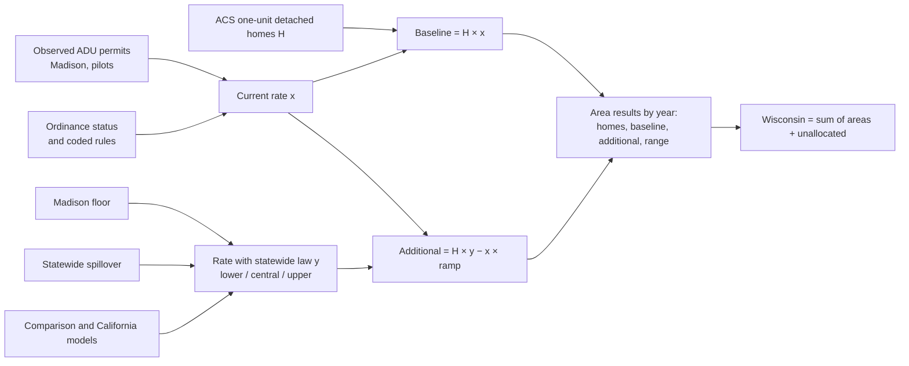

# Gate 1: ADU Scope and Model Outline

Revision 3, 2026-10-24. Consolidates the Gate 1 packet with the owner's decisions and feedback since (AQ-021 to AQ-028 in the [assumptions log](../ASSUMPTIONS_AND_QUESTIONS.md)). Earlier revisions are in git history. Numbers in the worked examples are **illustrative**; rates and ramps are set at Gate 3.

## The question

If Wisconsin enacted a statewide ADU law at the challenge benchmark, how many *additional* ADUs would local governments authorize by building permit over five years, compared with current local law; how confident are we; and where would they occur?

The answer is phrased the way a legislator would use it: *"Today Wisconsin produces about x ADU permits per 1,000 single-family homes a year. With this law we expect about y. That is roughly H × (y − x) more homes over five years, within this range, for these reasons."*

## Key assumptions at a glance

| # | Assumption | Status | Source |
| --- | --- | --- | --- |
| 1 | Outcome is ADU units authorized at permit issuance, five years | Adopted | AQ-001, AQ-021 |
| 2 | Law covers new detached and attached ADUs and garage/accessory-building conversions; interior conversions stay under current local rules | Adopted | AQ-030 |
| 3 | No owner-occupancy, related-occupant, or replacement-parking requirements | Adopted | AQ-022, AQ-030 |
| 4 | By-right (ministerial) approval required | Proposed | AQ-025 |
| 5 | Stylized dates: effective at start of year 1, labeled 2027–2031; local law frozen 2026-10-31 | Adopted | AQ-021 |
| 6 | Denominator is ACS one-unit detached homes | Adopted | AQ-021 |
| 7 | Additional = homes × (y − x); x observed or estimated from ordinance status | Adopted | AQ-028 |
| 8 | y floor = Madison's observed rate ÷ 0.8 (Madison is 80% benchmark), plus statewide spillover | Adopted direction; values at Gate 3 | AQ-024, AQ-027, AQ-029, AQ-030 |
| 9 | Unknown local rules behave like restricted, tested on a hold-out sample | Adopted direction | AQ-027 |
| 10 | Area-level results only; no lot-level forecasts | Adopted | AQ-018 |
| 11 | Ranges are evidence-informed scenario paths, not statistical intervals | Adopted | AQ-012 |

Questions still to confirm with the challenge organizers are listed under [Questions for office hours](../ASSUMPTIONS_AND_QUESTIONS.md#questions-for-office-hours).

## The modeled bill

- **Challenge benchmark:** one ADU allowed on every parcel with an existing single-family home; detached and semi-detached (attached) ADUs of at least 600 sq ft; no additional parking.
- **No poison pills (AQ-022):** no owner-occupancy or related-occupant requirement, following the Mercatus 2025 taxonomy (Hamilton and Peterson).
- **Forms and parking (AQ-030):** new detached and semi-detached ADUs and conversions of garages or accessory buildings; no replacement parking for a converted garage. Interior conversions are not required by the benchmark.
- **Approval pathway (AQ-025, decision at Gate 3):** proposed that the modeled bill requires ministerial, by-right approval, consistent with the no-poison-pills principle.
- Wisconsin has no statewide ADU law today; all four 2025–26 bills died (see [POLICY_EVIDENCE_MAP.md](POLICY_EVIDENCE_MAP.md) §1). Current law is entirely local.

## Outcome, units, and dates

- **Outcome:** ADU units authorized at local building-permit issuance, counted as dwelling units. Applications, issuance, completion, and net stock change stay separate.
- **What counts as an ADU:** a dwelling unit with its own kitchen, sanitation, and sleeping facilities for permanent habitation, accessory to a single-family home. Sheds, garages, and other accessory structures without living facilities are not ADUs.
- **Headline:** new detached and attached ADUs, plus conversions of existing space (garages, accessory buildings) shown as their own category (proposed, G2-3). Legalizations of existing units are tracked but never counted as production. The owner's ADU-equivalent rule (a new dwelling on a lot that already has one) is reported as a separate "second dwelling" series, because it mostly finds house-to-duplex conversions (proposed, G2-2).
- **Not net of substitution:** some ADUs may replace housing that would otherwise be built; stated as a limitation.
- **Dates (AQ-021):** stylized convention. The law takes effect at the start of forecast year 1; years 1–5 are labeled 2027–2031; current local law is frozen at 2026-10-31; an implementation lag is a sensitivity. 2026 is a bridge year, excluded from five-year totals.

## Geography

- **Policy authority:** municipality (about 1,850 cities, villages, and towns) plus 72 counties. A town is under county zoning only where the county adopted general zoning and the town board approved it (Wis. Stat. 59.69); a town with village powers may adopt its own.
- **Statewide ledger:** every municipality appears with homes, ordinance status, rights class where coded, permit coverage, and assumptions used. Municipalities plus an explicit unallocated row equal the state.
- **Display:** state totals and ranges lead; then counties and context groups (urban, suburban, small community, rural); municipalities and tracts are drill-downs. Small areas show a rate per 1,000 homes with whole-unit ranges. No lot-level forecasts (AQ-018).
- **Legislative districts:** later scenario cycle.

## Reading local rules: two passes (AQ-026)

**Pass 1, ordinance status** (cheap, scriptable): does the code have an ADU ordinance? `mentioned_allowed`, `prohibited`, `unmentioned`, or `could_not_access`. Only dwelling-unit terms count; a mention of accessory structures alone does not.

**Pass 2, rights class** (done for the 37 largest places so far; more later):

| Class | Meaning |
| --- | --- |
| `scenario_benchmark` | Benchmark rights already granted by right, with no restriction flag |
| `restricted` | Some ADU form allowed, with one or more restriction flags |
| `prohibited_explicit` | The code bars ADUs, or bars living quarters in accessory buildings |
| `prohibited_implicit` | Only listed uses are allowed and ADUs are not listed |
| `no_zoning` | No municipal or county zoning applies |
| `undetermined` | Not yet coded or not found (recorded, never replaced) |

**Restriction flags** apply only when a rule prevents a benchmark ADU on some single-family lots. An absolute size cap of 600 sq ft or more is not a flag; a percent-of-house, FAR, or coverage cap that can fall below 600 sq ft is.

- *Tier 1 (Mercatus core barriers):* owner occupancy; related occupant; extra parking (including replacement parking for the house); discretionary review; form limited.
- *Tier 2:* size below benchmark; siting limits; minimum lot; district limited; fees; other.

Under the outcome approach below, rules are not multipliers. Pass 1 helps estimate current production where permits are unobserved; pass 2 explains why production is low.

## The model (AQ-024, AQ-027, AQ-028)

For area *a*, forecast year *t* = 1..5, path *p*:

- `H[a]`: one-unit detached homes, ACS 2020–2024 control total. Parcels only allocate within areas.
- `x[a]`: ADU permits per 1,000 homes per year under current law.
  - **Observed** where we have permit records (Madison, Pleasant Prairie, Sun Prairie, and any place added later).
  - **Estimated** elsewhere from ordinance status and the coded places with observed permits: `unmentioned` or `prohibited` places get a small value near zero; `mentioned_allowed` places get a value estimated from observed places with ordinances. `undetermined` places are treated like restricted ones, not like outright bans (AQ-027). A hold-out sample of coded places tests this, with a simple regression later.
  - Places that liberalized in 2024–26 (for example Milwaukee, August 2025) are still ramping, so their `x` rises over the forecast (`g[a,t]`); Gate 3 works this through for Milwaukee.
- `y[a,p]`: expected rate once the statewide law is in force.
  - **Floor:** Madison's observed rate since April 2024, divided by 0.8 because Madison is about 80% of benchmark (Planned Development parcels and replacement parking outside the TOD overlay; AQ-029, AQ-030), applies everywhere (AQ-024). Rationale: a statewide law builds a specialized industry of contractors, lenders, and designers that one city's reform does not.
  - **Statewide spillover (AQ-027):** places already at or near benchmark also rise, because that industry markets and educates across the state. So `y > x` even in Madison and Wauwatosa.
  - **Paths:** lower uses the Madison floor; central and upper each come from a separate predictive model. Candidates: comparison places with post-reform data (Massachusetts, Austin, Minneapolis) for the central path; a California-style model for the upper path, including California's ADU share of all new units before and after 2020 (from HCD APR) applied to Wisconsin's Census BPS totals.
  - Paths move together across all areas and may differ in ramp speed as well as level.
- **Baseline:** `B[a,t] = H[a] × x[a] × g[a,t] / 1000`.
- **Additional:** `A[a,t] = H[a] × (y[a,p] − x[a]) × ramp[t,p] / 1000`, never below zero.
- **No double counting:** spillover is not added on top of a `y` already calibrated on statewide-reform evidence that includes it.

Plain language: count single-family homes; measure or estimate how many ADUs each place permits today; estimate how many it would permit with the statewide law (at least as many per home as Madison, plus a statewide boost); the difference, ramped up over five years, is the effect.

## Stock-gap "health" baseline (AQ-028)

Every scenario also shows current housing stock against a healthy benchmark (for ADUs, second dwellings on single-family lots; for middle housing, 2–4 unit buildings; for TOD, units near qualifying transit). The gap shows room to grow, not speed; five-year ADU forecasts come from permit rates, and the stock gap is a diagnostic and a check that forecasts stay within plausible headroom. ADU stock is hard to observe (ACS mixes attached ADUs with duplexes; Wisconsin parcels have no dwelling count), so this matters more for middle housing and TOD.

## Worked examples (illustrative, central path)

Illustrative values only: `y = 0.3` per 1,000 homes per year; ramp 0.4, 0.7, 1, 1, 1 (sum 4.1); spillover for benchmark-like places 20% of `x`.

| Case | x (current) | y (with law) | Additional over 5 years |
| --- | --- | --- | --- |
| A. Restrictive place, 10,000 homes, no permit records, ordinance mentions ADUs | 0.02, estimated | 0.3 | 10 × (0.3 − 0.02) × 4.1 ≈ **11** |
| B. Madison, 53,292 homes, observed | about 0.25, observed 2024–26 (2026 runs near 0.35) | 0.25 × 1.2 = 0.30 (spillover) | 53.3 × 0.05 × 4.1 ≈ **11** |
| C. Unknown place, 10,000 homes, ordinance unmentioned | about 0, estimated | 0.3 | 10 × 0.3 × 4.1 ≈ **12**, labeled estimated |

If half of Wisconsin's 1.84 million detached homes were like case C, the central path would give roughly 1,100 additional permits over five years; if nearly all were, roughly 2,200. The size of `y` drives the statewide answer far more than the precision of rule coding.

## What you will see

The state total and range lead, then county and context-group totals. Smaller areas show rates per 1,000 homes with whole-unit ranges; small modeled values are rounded and labeled, never hidden. Only observed permit counts small enough to identify a household are suppressed.

## Privacy

Committed files keep ZIP code, city, county, and street name; they drop house numbers, unit numbers, and owner names. Parcel numbers are masked in committed samples. Full addresses and parcel numbers stay in local, git-ignored files, where all map and parcel joins run.

## Decisions still open

- Modeled bill requires ministerial approval (AQ-025): proposed yes.
- Size of statewide spillover and its evidence (AQ-027).
- Method for estimating `x` where permits are unobserved, and the hold-out test (AQ-027, AQ-028).
- Central and upper predictive models and their ramps (AQ-024).
- Gate 2 decisions G2-1 to G2-6 ([Gate 2 packet](../gate2/README.md)).
