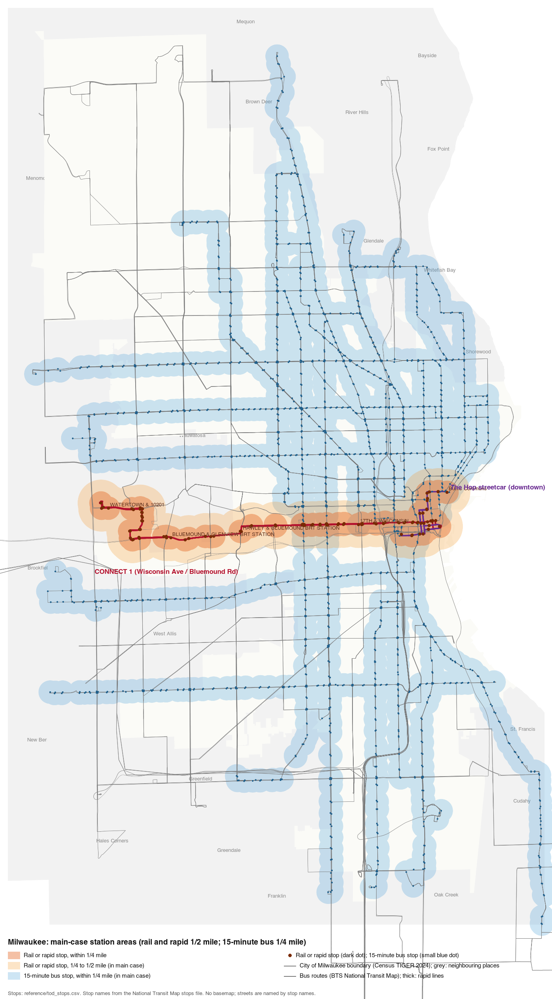
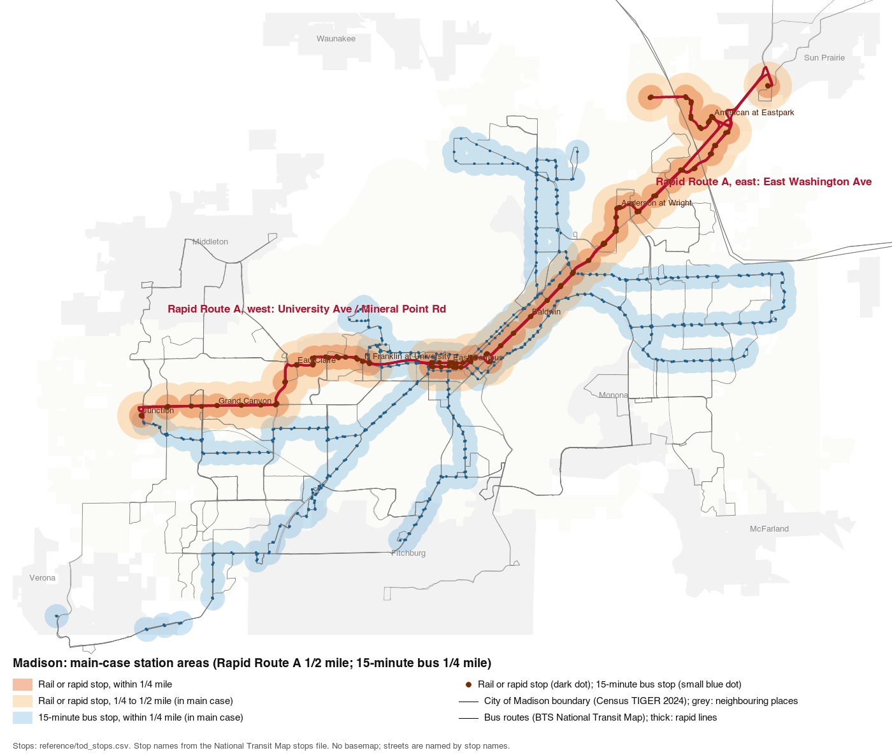
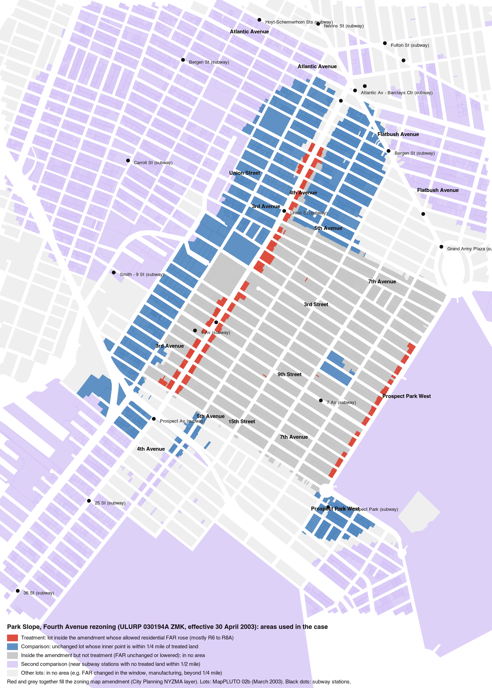

# TOD Gate 2: worked examples for the owner's review

Written 2026-10-26 for the Gate 2 owner review ([MVP_EXECUTION_PLAN.md](../MVP_EXECUTION_PLAN.md), Gate 2, "Owner review: step by step", steps 2 to 5). Every example below was produced by running the repository's own case code ([case_charlotte.py](../../missing_middleware/tod/case_charlotte.py), [case_nyc.py](../../missing_middleware/tod/case_nyc.py), [cases.py](../../missing_middleware/tod/cases.py)) on the raw files in `data/raw/tod_cases/`, with extra bookkeeping added only to record how each permit was located. The area totals rebuilt this way match [reference/tod_case_rates_by_year.csv](../../reference/tod_case_rates_by_year.csv) exactly: 0 of the area-year unit totals differ for Charlotte, Park Slope and Downtown Brooklyn.

**Privacy rules used in this file.** Permit numbers, parcel ids, and New York block and lot numbers (the parts of a BBL) are cut to their first 2 characters, with the rest shown as `x`. Owner and applicant names are dropped. Street names are kept; house numbers are dropped, including from project names. Point coordinates are not shown.

Contents:
1. [Source records beside the cleaned rows](#1-source-records-beside-the-cleaned-rows)
2. [One permit followed end to end, and one that could not be located](#2-one-permit-followed-end-to-end-and-one-that-could-not-be-located)
3. [Zoning classifications with dated sources](#3-zoning-classifications-with-dated-sources)
4. [Map check](#4-map-check)
5. [Location-match rates](#5-location-match-rates)
6. [Quality findings from the examples](#6-quality-findings-from-the-examples)

## 1. Source records beside the cleaned rows

### Charlotte (Mecklenburg County building permits, `permits.csv`)

The cleaned row is what `case_charlotte.load_permits()` keeps and what the area step then adds. The filter keeps Census use codes 101 to 105 and 115 (new buildings with 1 to 5+ homes), drops additions and work on existing buildings, drops 1-unit placeholder permits for garages and amenity areas, and keeps permits with at least 1 unit.

| Field | Permit A (treatment) | Permit B (comparison) | Permit C (not located) |
| --- | --- | --- | --- |
| Raw `permitnum` | B4xxxxxx | B2xxxxxx | B4xxxxxx |
| Raw `projname` (house numbers removed) | Oliver at Tom Hunter, Building 2, Base/Unit/Common Area | Sovereign at Belgate, Building 700 | Dillehay Court Apartments |
| Raw `projadd` (street only) | McGill St | Lewis St | W 30th St |
| Raw `parcelnum` | 04xxxxxx | 04xxxxxx | 08xxxxxx |
| Raw `usdcdesc` | 105, 5 or More Family Apartments | 105, 5 or More Family Apartments | 105, 5 or More Family Apartments |
| Raw `typeofbldg` / `worktype` | New Bldg / blank | New Bldg / blank | New Bldg / blank |
| Raw `numunits` | 57 | 42 | 144 |
| Raw `issuedate` | 2021-10-06 | 2015-06-02 | 2021-07-07 |
| Cleaned `units` | 57 | 42 | 144 |
| Cleaned `year` | 2021 | 2015 | 2021 |
| Cleaned `project` (for resampling) | parcel number (04xxxxxx) | parcel number (04xxxxxx) | parcel number (08xxxxxx) |
| How located | permit point inside a parcel | permit point inside a parcel | not located: nearest parcel in the layer is 33.3 m away; the limit is 30 m |
| Located parcel id equals the permit's parcel number? | yes | yes | not applicable |
| Zoning before → after | B-D(CD) → TOD-TR (Petition 2019-102) | CC, unchanged | not applicable |
| Area | treatment, eligible | comparison, eligible | none |
| Period | after (year 2 after 2019) | before | after, but not counted |

### Park Slope (NYC Department of Buildings new-building jobs, `dob_nb_brooklyn.csv`)

The cleaned row is what `case_nyc.load_jobs()` keeps: one record per job number, units = `proposed_dwelling_units`, year = the year in `fully_permitted`, and only jobs with at least 1 unit and a geocoded point.

| Field | Job D (treatment, id match) | Job E (treatment, nearest lot) | Job F (comparison, id match) |
| --- | --- | --- | --- |
| Raw `job__` | 30xxxxxxx | 30xxxxxxx | 30xxxxxxx |
| Raw `street_name` (house number dropped) | Fourth Avenue | 2 Street | Warren Street |
| Raw `block` / `lot` | 01xxx / 00xxx | 00xxx / 00xxx | 00xxx / 00xxx |
| Raw `job_status_descrp` | SIGNED OFF | SIGNED OFF | SIGNED OFF |
| Raw `fully_permitted` | 04/10/2007 | 11/24/2004 | 10/13/1999 |
| Raw `proposed_dwelling_units` | 156 | 69 | 96 |
| Raw `proposed_no_of_stories` | 12 | 12 | 6 |
| Cleaned `units` | 156 | 69 | 96 |
| Cleaned `year` | 2007 | 2004 | 1999 |
| Cleaned `project` | block-lot of the job | block-lot of the job | block-lot of the job |
| How located | block and lot found in MapPLUTO 02b (id match) | block and lot not in 02b (a lot number created after March 2003); nearest 02b lot, 5.6 m from the job's point | id match |
| Lot zoning, March 2003 (02b) → late 2004 (04c) | R6 → R8A | R6 → R8A | R7B → R7B |
| Allowed residential FAR, before → after | 3.0 → 6.02 | 3.0 → 6.02 | 3.0 → 3.0 |
| Area | treatment, eligible | treatment, eligible | comparison, eligible |
| Period | after | after | before |

## 2. One permit followed end to end, and one that could not be located

### Followed end to end: Job D, Fourth Avenue, Park Slope

1. **Raw record.** Department of Buildings job 30xxxxxxx on Fourth Avenue, document 01 (new building), fully permitted on 10 April 2007, proposing 156 homes in 12 stories.
2. **Cleaning.** It is the only record with that job number, so de-duplication keeps it. Units = 156; year = 2007; project key = its block and lot.
3. **Locating the lot.** `locate_jobs` first looks up the job's block and lot in MapPLUTO 02b (March 2003). That block and lot exist, so the job is placed on that lot by **id match**. The job's own map point is 15.7 m from the lot (DOB points sit on the street frontage), which agrees with the id match. Had the id not been found, the code would have used the lot containing the point, or else the nearest lot within 40 m.
4. **Treatment, comparison or neither.** The lot's representative point lies inside the zoning map amendment ULURP 030194A ZMK (effective 30 April 2003). Its district went from R6 (FAR 3.0) in 02b to R8A (FAR 6.02) in 04c, so its allowed density rose. R6 has no separate homes-per-acre cap, but its FAR 3.0 is below the acre-weighted median new level on rising land, so it is not "already at the law". Its zoning did not change again between 04c and 09v2. Its 2003 land use code is 05 (commercial and office), which is eligible. Result: **treatment, eligible**.
5. **Year and area row.** It adds 156 units to the row `nyc_park_slope_fourth_ave_2003, treatment, 2007, after` in `reference/tod_case_rates_by_year.csv`. That row holds 297 units in total over 19.1 eligible acres, a rate of 15.58 units per eligible acre in that year (297 units ÷ 19.1 acres). The 297 units are four jobs: 156 + 32 (1 Street) + 49 (4 Avenue) + 60 (7 Street). A fifth 2007 job in the treatment area, 56 units on 4 Avenue, is left out because its lot was zoned M1-2 (manufacturing) before the change, which is not eligible land.

The same path for a Charlotte permit: Permit A above was placed by its point falling inside parcel 04xxxxxx, whose representative point lies in a Petition 2019-102 polygon (B-D(CD) to TOD-TR, approved 18 November 2019). It adds 57 units to `charlotte_tod_2019, treatment, 2021, after`, which holds 231 units over 817.5 eligible acres (rate 0.283 units per eligible acre). Three of the four Oliver at Tom Hunter permits fall in 2021 (57 + 57 + 50 = 164 of the 231 units).

### Could not be located: Permit C, Dillehay Court Apartments, Charlotte

- **Raw record.** Permit B4xxxxxx, 144 units, use code 105, issued 7 July 2021, W 30th St, parcel number 08xxxxxx.
- **Why it was not located.** Charlotte's adapter places a permit by its point: first the parcel containing the point, else the nearest parcel within 30 m (`cases.locate_points`, default `max_m = 30`). The adapter does not use the permit's parcel number. This permit's point is inside the 50 m search buffer around the fetched parcel layer but 33.3 m from the nearest parcel in it. Its own parcel number is not in the layer at all, because `parcels.geojson` covers only land near the corridor and rail stops.
- **Does it matter?** No measured area loses it. The nearest parcel is in no area. The same holds for all 267 unlocated window permits (888 units): 0 of the 267 have a parcel number that appears in the parcel layer, and 0 of the 267 have a nearest parcel that is in an area.

**Park Slope has no unlocated example.** In the case window (1997 to 2008), 0 of 12,045 Brooklyn jobs with units failed to locate. In the whole Brooklyn file, 7 of 19,605 jobs with units and a permit date have no coordinates, and all 7 fall outside 1997 to 2009, so they never reach any area. The closest thing to a failure is the opposite problem, shown in section 6: an id match that disagrees with the job's point.

## 3. Zoning classifications with dated sources

### New York: Park Slope, Fourth Avenue

- **Source.** NYC Department of City Planning zoning map amendment layer (`nyzma.geojson`): ULURP number **030194A ZMK**, project name "PARK SLOPE REZONING", status Adopted, effective **30 April 2003** (the layer's `EFFECTIVE` field). The before and after zoning of each lot comes from MapPLUTO 02b (March 2003) and 04c (late 2004).
- **One block front.** The lot of Job D (Fourth Avenue) went from **R6 to R8A**. The code's allowed residential FAR (`RESID_FAR` in case_nyc.py, Zoning Resolution 23-141 and 23-145 as in force 2002 to 2004, the higher of the height-factor and Quality Housing wide-street maximums, no inclusionary bonus) is **3.0 for R6 and 6.02 for R8A**, so the lot's added FAR is **3.02**.
- **How the whole case's dose is built.** The dose is the acre-weighted mean of added FAR over the 19.1 eligible treatment acres:

| Before → after | Lots | Eligible acres | FAR before → after | Added FAR |
| --- | --- | --- | --- | --- |
| R6 → R8A (Fourth Avenue) | 162 | 11.00 | 3.0 → 6.02 | 3.02 |
| R6 → R7A (Prospect Park West) | 64 | 4.74 | 3.0 → 4.0 | 1.00 |
| R7A → R8A (Fourth Avenue, north end) | 70 | 2.79 | 4.0 → 6.02 | 2.02 |
| R6B → R8A | 1 | 0.40 | 2.0 → 6.02 | 4.02 |
| R6 → R8B and R6B → R8B | 3 | 0.13 | 3.0 or 2.0 → 4.0 | 1.0 or 2.0 |

  The acre-weighted mean is 2.381 added FAR (about 45.4 acre-FAR ÷ 19.1 acres), the `dose_added_far` in [reference/tod_case_estimates.csv](../../reference/tod_case_estimates.csv). The same amendment lowered or kept the allowed FAR on most of the interior blocks (for example 184.6 acres went from R6 to R6B and 41.2 acres from R6 to R7B); those lots are in no area (grey on the map in section 4).
- **A caution for the reviewer.** R6's 3.0 is the Quality Housing wide-street maximum. On narrow streets or under height-factor rules R6 allows less (about 2.43), so the added FAR on Fourth Avenue could be read as larger. The code's choice is stated in its docstring.

### Wisconsin: Milwaukee LB2 (Local Business), a common district along Wisconsin Avenue and other corridors

From [reference/tod_zoning_rules_milwaukee.csv](../../reference/tod_zoning_rules_milwaukee.csv):

| Field | Value |
| --- | --- |
| District | LB2, commercial |
| Rule type | density |
| Minimum lot area per home | 800 sq ft |
| Maximum height | 60 ft |
| Maximum lot coverage | none printed (model default 0.7 used) |
| Code section | Milwaukee Code of Ordinances, Table 295-605-2 |
| Source URL | https://web.archive.org/web/20250323063843/https://city.milwaukee.gov/ImageLibrary/Groups/ccClerk/Ordinances/Volume-2/CH295-sub6.pdf |
| Source capture date | 23 March 2025 (Internet Archive copy; the city site blocks scripts) |
| Status | verified (the number is printed in the source) |

How `capacity.district_rule` turns this into a current allowance: 43,560 sq ft per acre ÷ 800 sq ft per home = **54.45 homes per acre**. The floor-area check is 60 ft ÷ 11 ft = 5 stories × 0.7 coverage = FAR 3.5, which at 1,000 sq ft per home would allow about 152 homes per acre, so the density limit binds at 54.45. The modelled law within ¼ mile of a rail or rapid stop is 100 homes per acre (FAR 3.0, 65 ft). In the main-case station areas of Milwaukee there are 970.5 eligible LB2 acres; the current rules allow 52,844.5 homes on them on paper and the modelled law would allow 78,877.9 (from [reference/tod_station_areas.csv](../../reference/tod_station_areas.csv), rows with `in_main` = 1).

A Madison counterpart: TSS (Traditional Shopping Street) in [reference/tod_zoning_rules_madison.csv](../../reference/tod_zoning_rules_madison.csv), source Zoning District Summary pages 2 and 6 (MGO ch. 28 and 28.104), https://www.cityofmadison.com/development-services-center/documents/ZoningTable.pdf, dated 13 March 2026, verified: 124 homes per acre printed, 3 stories, 4 stories inside the TOD overlay. The model's allowance is 91.5 homes per acre outside the overlay (3 stories × 0.7 = FAR 2.1) and 122.0 inside it (4 stories × 0.7 = FAR 2.8), because the floor-area estimate binds before the printed density.

## 4. Map check

All three maps are drawn only from files already in the repository or fetched by its scripts (no basemap tiles): stops from `reference/tod_stops.csv`, stop names and route lines from the BTS National Transit Map files in `data/raw/tod_transit/ntm/`, city outlines from Census TIGER 2024 places, and New York lots from MapPLUTO 02b. Lakes and streets are not drawn; streets are named through stop names, and in Brooklyn through lot addresses.

### Milwaukee: [img/gate2_milwaukee_station_areas.png](img/gate2_milwaukee_station_areas.png)

What a reviewer should see:
- The **CONNECT 1** line (thick red) runs west from downtown along **Wisconsin Avenue** (stop "17th & Wisconsin"), continues on **Bluemound Road** (stops "Hawley & Bluemound BRT Station" and "Bluemound & Glenview BRT Station") and ends near the regional medical center (stop "Watertown & 10201"). Its stops carry the ¼ mile (dark orange) and ½ mile (light orange) station areas, so the orange band is a continuous east-west strip about 1 mile wide.
- **The Hop** streetcar (purple) is a short line through downtown toward the lakefront; its ½ mile areas merge with CONNECT 1's at the east end.
- The **15-minute bus** ¼ mile areas (blue) follow the main grid corridors, north-south and east-west, across the north side and the south side, and reach into Wauwatosa, West Allis and other suburbs.
- In the drawn frame there are 106 rail or rapid stops and 1,938 further 15-minute bus stops (counts of points on the map, not all inside the city).

### Madison: [img/gate2_madison_station_areas.png](img/gate2_madison_station_areas.png)

What a reviewer should see:
- **Rapid Route A** (thick red) runs from the far west side (stops "Junction" and "Grand Canyon") east past "Eau Claire" and "N Franklin at University" on the **University Avenue** corridor, through the campus and downtown isthmus, then northeast along **East Washington Avenue** (stops "Baldwin" and "Anderson at Wright") to "American at Eastpark" and on to Sun Prairie.
- The orange ½ mile band follows the whole line. The blue 15-minute bus areas cover the other frequent routes, for example the south and southeast branches toward Fitchburg and Monona and a loop on the east side.
- Lakes Mendota and Monona are not drawn; the empty space north and south of the isthmus is where they are.
- In the drawn frame there are 138 rapid stops (including Route A stops in Shorewood Hills and Sun Prairie) and 541 further 15-minute bus stops.

### Park Slope: [img/gate2_park_slope_areas.png](img/gate2_park_slope_areas.png)

What a reviewer should see:
- **Treatment (red)** is two thin strips: the block fronts along **Fourth Avenue** (R6 or R7A to R8A) and along **Prospect Park West** facing the park (R6 to R7A).
- **Grey** is the rest of the amendment: the interior brownstone blocks that were kept or lowered (mostly R6 to R6B or R7B). They are in no area.
- **Comparison (blue)** is the unchanged land within ¼ mile of the treated lots, outside the amendment: mostly west of Fourth Avenue toward Third Avenue and north toward Atlantic Avenue and Flatbush Avenue, plus a pocket at the park's southwest corner near the Prospect Park subway station.
- **Second comparison (lavender)** is land near subway stations whose ½ mile area holds no treated land. It is large and spreads well beyond the frame.
- Subway stations shown for orientation include 4 Av, 7 Av, Union St, Prospect Av, Atlantic Av - Barclays Ctr and Grand Army Plaza.

## 5. Location-match rates

Definition used: among **window permits** (records that pass each case's outcome filter, that is new residential construction with at least 1 unit, a permit year and a point, with a year inside the case's before, year 0 and after years), the share placed on a lot or parcel, split by the method that placed it. Counts are permits (Charlotte) or jobs (New York), not units, unless stated.

**Charlotte** (window 2013 to 2024; permits whose point lies within 50 m of the fetched parcel layer, which is the adapter's search set):
- Located: 12,107 of 12,374 permits (97.8%).
  - Point inside a parcel: 11,508 of 12,374 (93.0%).
  - Nearest parcel within 30 m: 599 of 12,374 (4.8%).
- Not located: 267 of 12,374 (2.2%), holding 888 of 49,119 units (1.8%).
- There is no parcel-id matching step in this adapter. As a check, 10,967 of the 12,107 located permits (90.6%) landed on the parcel whose id equals the permit's own parcel number.
- Permits that ended up in a measured area (treatment, comparison or second comparison): 2,330. Of these, 2,218 (95.2%) were inside their parcel and 112 (4.8%) were placed on the nearest parcel within 30 m.
- Over all years 1990 to 2026 the located share is 27,584 of 29,012 permits (95.1%), the `permits_located_share` 0.9508 in `data/processed/tod_cases/diagnostics.json`.

**Park Slope** (window 1997 to 2008; all Brooklyn new-building jobs, since the lot layer covers all of Brooklyn):
- Located: 12,045 of 12,045 jobs (100%).
  - Block and lot id match in MapPLUTO 02b: 8,233 of 12,045 (68.4%).
  - No id match; point inside a lot: 387 of 12,045 (3.2%).
  - No id match; nearest lot within 40 m: 3,425 of 12,045 (28.4%). For these, the median distance from the point to the lot is 9.0 m and the largest is 32.5 m.
- Not located: 0 of 12,045.
- In the treatment area: 14 jobs, of which 13 by id match and 1 by nearest lot (Job E). In the comparison area: 41 jobs, all 41 by id match.

**Downtown Brooklyn** (window 1998 to 2009; same file and method):
- Located: 12,115 of 12,115 jobs (100%): id match 8,269 (68.3%), point inside a lot 427 (3.5%), nearest lot within 40 m 3,419 (28.2%).
- In the treatment area: 9 jobs (7 by id match, 2 by nearest lot). In the comparison area: 61 jobs (42 by id match, 19 by nearest lot).

The other two cases were not re-split by method here; their all-year located shares in `diagnostics.json` are 92.4% of projects for Saint Paul and 99.99% of permits for Chicago (held out).

## 6. Quality findings from the examples

1. **Id match beats the point, even when they disagree badly.** In the Park Slope window, 36 of 8,233 id-matched jobs (0.4%) have their own point more than 100 m from the matched lot, and 193 of 8,233 (2.3%) more than 40 m. One of them reaches the Park Slope comparison area: a 3-unit job on Bergen Street (2005) whose block and lot point to a Park Slope lot while its point is 1,345 m away. Either the block and lot or the address is wrong in the DOB record. It adds 3 of the 30 units in the comparison 2005 row.
2. **A possible duplicate behind Job E.** Job E (69 units, 2004, 2 Street) carries a lot number created after March 2003 and was placed by distance on the same 02b lot as another job on 2 Street (46 units, fully permitted in 2003, 5 stories). The two have different job numbers, house numbers and storey counts, so they may be two buildings, but they may also be a refiled job for one site. If they are one building, the treatment area's 2003 (year 0) or 2004 (after) total would be overstated by 46 or 69 units. This is worth one look before Gate 3.
3. **Charlotte per-floor permits are not double counts in the example checked.** The four Oliver at Tom Hunter permits (57, 57, 50 and 50 units) list different unit numbers in their descriptions (53, 57, 58 and 50 unit-like numbers), so they cover different floors and buildings. Two of them have project names that look swapped against their descriptions; the unit totals are unaffected.
4. **Nearest-parcel placement can pick a neighbour.** Two 1-unit condominium permits on Euclid Ave (2018) were placed 24.9 m away on a neighbouring parcel recorded as a fast-food site, because the condominium parcel ids are not in the parcel layer. The neighbour is in the same treatment area, so the count is right, but the parcel id is not. Of the located Charlotte window permits whose parcel number differed from the placed parcel, only 132 had a parcel number present in the layer, and in only 1 of those would using the parcel number have changed the area.
5. **Charlotte uses a 30 m nearest-parcel limit, New York uses 40 m.** This is how the adapters are written (`locate_points` default versus `locate_jobs`). The 267 unlocated Charlotte permits are all 30 to 50 m from the nearest parcel and none sits next to a measured area, so raising the limit to 40 m would not change any area total.
